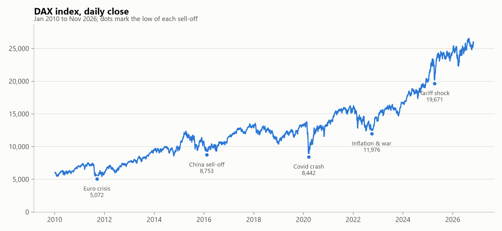
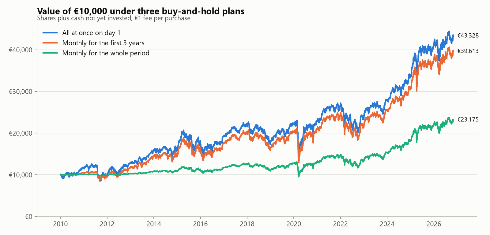
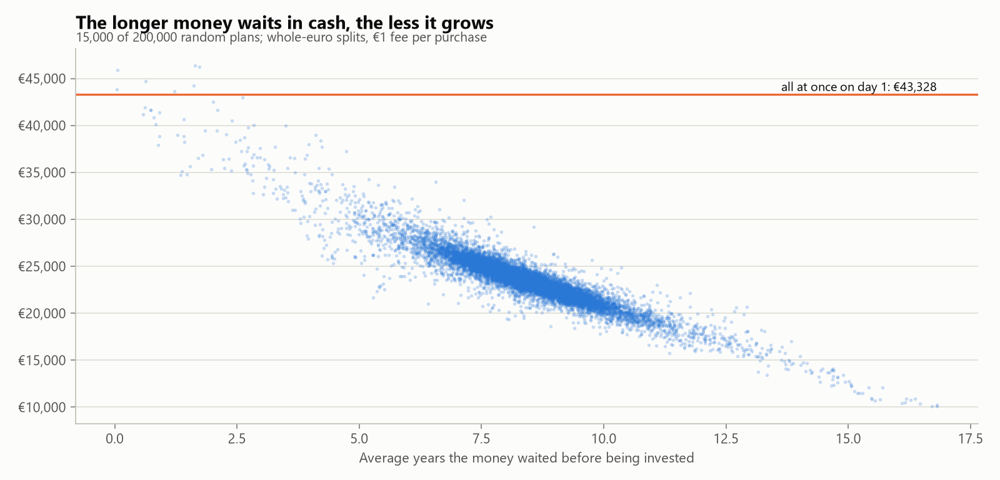
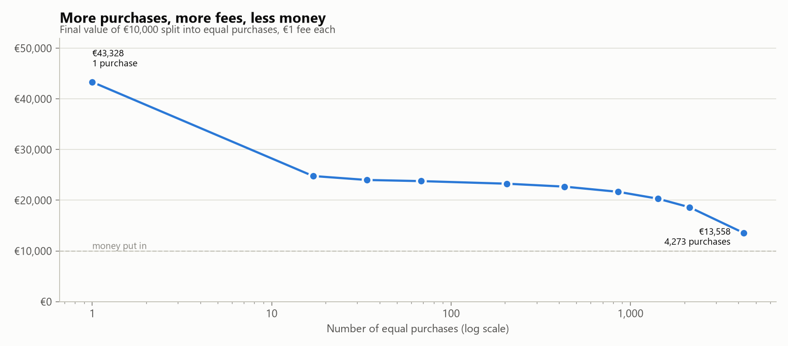
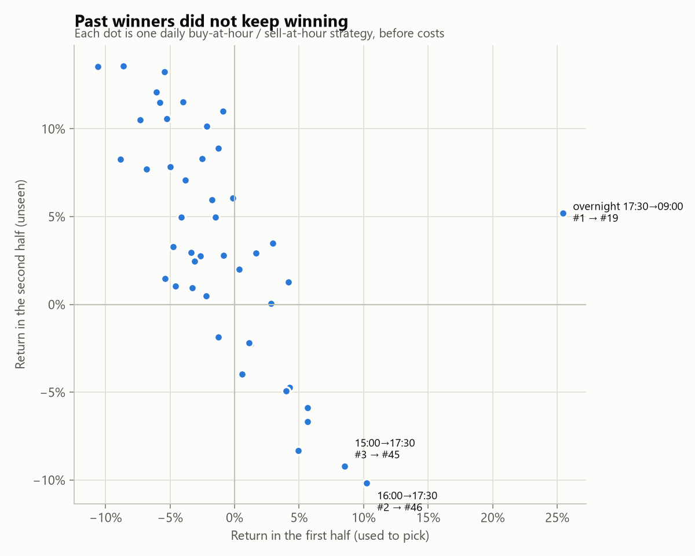

# When should you buy the DAX?

A backtesting study of buy-and-hold, dollar-cost averaging, dip-buying and
hour-of-day timing on the German DAX index, using 17 years of daily prices and
2 years of hourly prices.

The question: **you have €10,000 and pay €1 per purchase. Is it better to
invest it all at once, spread it out, wait for dips, or pick the right day or
hour?** The project tests this with fixed rules, an exhaustive search of
43,758 ways to split the money, and a Monte Carlo simulation of 200,000 random
investment plans.

> The full output, with every table, is in [results/REPORT.md](results/REPORT.md).
> Data from 4 Jan 2010 to 2 Nov 2026. Past results do not predict future!!!
> returns, and nothing here is financial advice!!!



## About the DAX

The **DAX** (Deutscher Aktienindex) is Germany's main stock market index. It
tracks the **40 largest German companies** listed on the Frankfurt Stock
Exchange, such as SAP, Siemens, Allianz, Deutsche Telekom, Airbus and
Mercedes-Benz. It had 30 members until September 2021.

| | |
| --- | --- |
| Run by | Deutsche Börse (calculated by its index business, STOXX) |
| Started | 1 July 1988, from a base value of 1,000 at the end of 1987 |
| Weighting | By free-float market value, with any one company capped at 10% |
| Trading hours | Xetra, 09:00 to 17:30 Frankfurt time, updated every second |
| Type | Performance (total-return) index: dividends are counted as reinvested |
| ISIN | DE0008469008 |

**Tickers**

| Source | Ticker |
| --- | --- |
| Yahoo Finance (used here) | `^GDAXI` |
| Bloomberg | `DAX Index` |
| Reuters / LSEG | `.GDAXI` |

The index itself can't be bought. Investors get the same exposure through DAX
ETFs, for example iShares Core DAX UCITS ETF (Xetra: `EXS1`), which is the kind
of product the buy-only plans in this study imitate.

## Key findings

### 1. Investing everything on day one beat almost every alternative

€10,000 invested on 4 January 2010 became **€43,328 (9.1% a year)**. Spreading
the same money over monthly purchases did worse the longer the spreading took:

| Plan | Final value | CAGR | Worst drop |
| --- | ---: | ---: | ---: |
| All at once on day 1 | €43,328 | 9.1% | −38.8% |
| Monthly over the first year | €42,146 | 8.9% | −38.8% |
| Monthly over the first 3 years | €39,613 | 8.5% | −38.8% |
| Monthly over the whole 17 years | €23,175 | 5.1% | −27.1% |



### 2. Random splitting doesn't help; only the waiting time matters

200,000 random plans split the €10,000 into 1 to 100 whole-euro parts of
random size, each bought on a random day. **Only 0.05% beat investing
everything on day one**, and all of them were lucky single purchases near the
2011 euro-crisis low. The median plan ended at €23,456.

What separated good plans from bad ones was how long the money sat in cash
before being invested. The number of parts barely moved the median; more parts
only narrowed the range between best and worst outcomes.



### 3. Fees punish frequent buying

With a €1 fee, buying every trading day costs €4,273 in fees and ends at
€13,558. Weekly buying costs €855 in fees.



### 4. Dip-buying only won when a crash came soon after the start

Holding cash and buying in chunks after the DAX fell 5–20% from its peak never
beat investing on day one from a 2010 start. From other start years it lost
too, often by a lot, because the cash waited for dips that came late or never:

| Start | All at once | Monthly, 1 year | 10% dips | 20% dips |
| --- | ---: | ---: | ---: | ---: |
| 2010 | **€43,328** | €42,572 | €38,069 | €32,129 |
| 2013 | **€33,671** | €31,522 | €25,516 | €21,682 |
| 2016 | €24,691 | **€25,360** | €22,759 | €14,917 |
| 2019 | **€24,710** | €21,602 | €19,881 | €14,229 |
| 2022 | €16,235 | **€18,649** | €15,642 | €12,071 |

Spreading over the first year won from two of the five start years, so it is
a reasonable choice for anyone worried about buying right before a fall.

### 5. Timing within the day, week or month barely matters

- Buying monthly at each day's **lowest** price, which is impossible in
  practice, beat buying at the **highest** price by only €372 over 17 years.
- Buying on any weekday ends within €34 of the others.
- Over the two years of hourly data, the purchase hour changed the final value
  of a one-off €10,000 investment by €60 at most.

### 6. Hour-of-day trading patterns didn't last

46 daily strategies bought at one hour and sold at a later one, or held
overnight. Before costs, holding overnight (17:30 close to 09:00 open) did
best: €13,195 from €10,000. But:

- after a 0.05% cost per round trip it falls to €10,252, and every
  intraday strategy loses money;
- the best strategies of the first year mostly flipped in the second: #2
  became #46 and #3 became #45.



### Conclusion

For a long-term investor paying a fixed fee per purchase, the simplest plan
won: **invest early, keep fees low, and hold.** Clever timing rules either
cost money or only worked in hindsight. This matches Warren Buffett's standing
advice that most people should buy a low-cost index fund and hold it.

## Methodology

- **Data**: daily (from 2010) and hourly (last ~2 years, the limit of the free
  source) DAX prices from Yahoo Finance, ticker `^GDAXI`.
- **Buy-only plans**: purchases happen at the day's open unless stated
  otherwise. Each purchase costs a fixed €1 fee. Nothing is sold, and
  everything is valued at the last close. Uninvested money is held as cash at
  0% interest.
- **Metrics**:
  - **CAGR**: yearly growth of the whole €10,000 from the first day.
  - **Money-weighted CAGR (IRR)**: growth of the money only while invested.
    It flatters late investing, which is why plans are ranked by final value.
  - **Worst drop**: largest fall of the whole budget, shares plus cash, from a
    previous peak.
- **Exhaustive search**: all 43,758 ways to place €1,000 chunks on 9 dates two
  years apart.
- **Monte Carlo**: 200,000 plans with a random number of parts (1–100), random
  whole-euro amounts (at least €50 each, summing to exactly €10,000) and random
  purchase days. The seed is fixed, so results are reproducible.
- **Robustness checks**: rerunning plans from later start years, and ranking
  hourly strategies on the first half of the data, then testing them on the
  unseen second half.

### Limitations

- **One index, one period.** The DAX mostly rose from 2010 to 2026. In a
  long-falling market, spreading purchases or buying dips would look better.
- **The DAX is a total-return index**, so dividends are already reinvested.
  Real ETFs add a small yearly fee and tracking differences.
- **Only a fixed €1 fee is modelled.** There is no bid-ask spread on buy-only
  plans, and no taxes.
- **Cash earns 0%.** Interest on waiting cash would help the spreading and dip
  strategies a little.
- **The hourly results cover only two years**, so they are weaker evidence.

## Reproduce it

Requires [uv](https://docs.astral.sh/uv/getting-started/installation/).

```bash
uv sync
uv run dax-report --download   # fetch the data, run everything, write results/
uv run pytest                  # tests use synthetic data, no network needed
```

`dax-report` writes `results/REPORT.md` and the charts. Without `--download`
it reuses the files in `data/`. Options let you change the assumptions:

```bash
uv run dax-report --budget 5000 --fee 2.5 --plans 500000 --seed 7
```

Run `uv run dax-report --help` for all options.

**Downloading prices on their own** with the `dax-history` command:

```bash
uv run dax-history --start 2010-01-01 --output data/dax_daily.csv        # daily
uv run dax-history --interval 1h --output data/dax_hourly.csv --append  # hourly
```

`--interval` accepts `1d`, `1h`, `30m`, `15m`, `5m` or `1m`. Yahoo only keeps
about 2 years of hourly bars and 60 days of 30-minute ones. Re-running with
`--append` merges new bars into the file, so an intraday history can be built
up over time. The extension `.csv` or `.xlsx` picks the format.

## Project structure

```
src/dax_history/
├── fetch.py            # Yahoo Finance download, interval limits, request chunking
├── storage.py          # CSV/Excel read, write and merge
├── cli.py              # dax-history command
└── analysis/
    ├── data.py         # loading and cleaning price files
    ├── metrics.py      # CAGR, IRR, drawdown, budget splits
    ├── plans.py        # buy-only engine and the daily strategies
    ├── random_plans.py # Monte Carlo of random plans
    ├── intraday.py     # hour-of-day strategies
    ├── charts.py       # matplotlib charts
    └── report.py       # dax-report command, writes results/REPORT.md
tests/                  # pytest suite on synthetic prices
results/                # generated report and charts
```

Built with Python, pandas, NumPy, matplotlib and yfinance.

## Data and disclaimer

Prices come from Yahoo Finance through the unofficial
[yfinance](https://github.com/ranaroussi/yfinance) library. Yahoo's terms don't
allow redistributing the data, so it isn't included in this repository.
`dax-report --download` fetches it for personal use.

This project is an educational analysis of historical data. It isn't investment
advice, and past performance doesn't guarantee future results.
