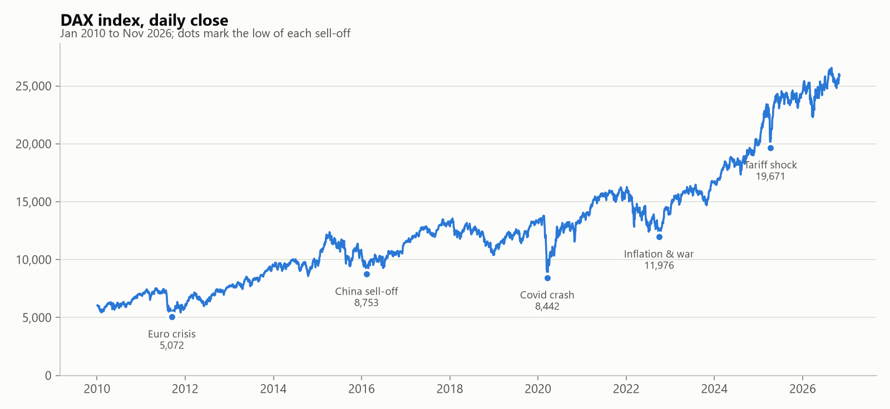
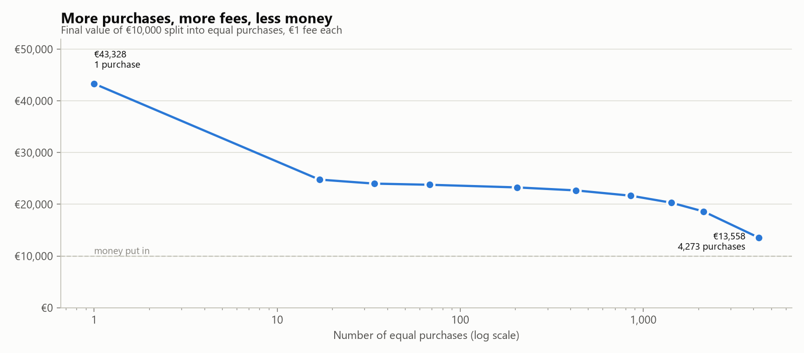
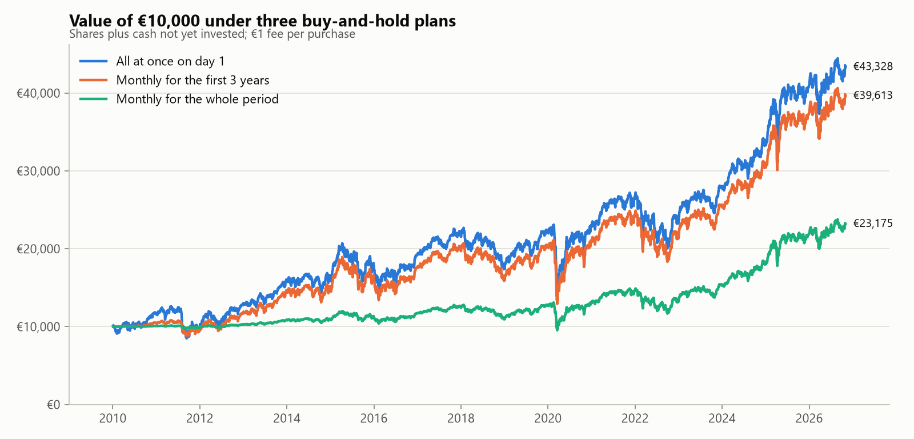
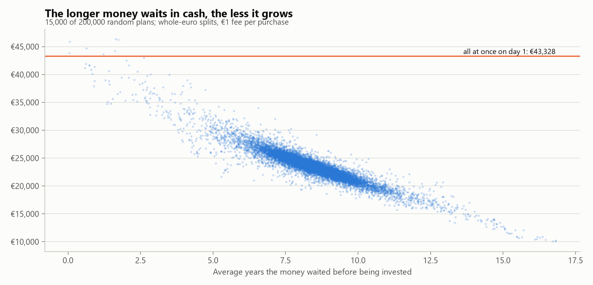
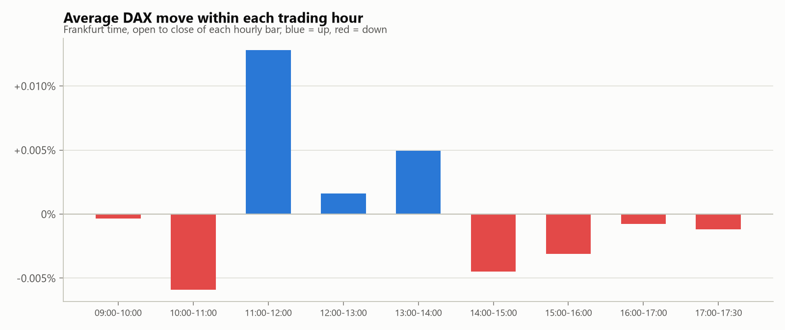
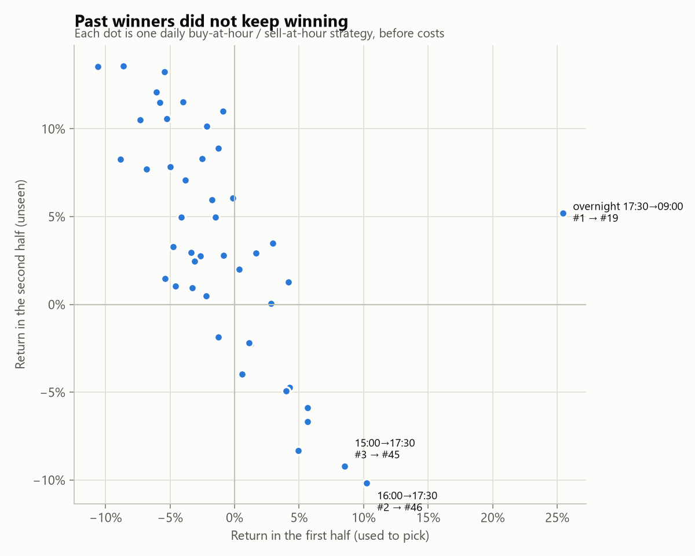

# DAX investing study – full results

Generated on 02 November 2026 by `dax-report`. Data: Yahoo Finance, ticker `^GDAXI`. Past results do not predict future returns; this is not financial advice.

## Part 1 – Daily prices, 04 Jan 2010 to 02 Nov 2026

4,273 trading days (16.8 years). The DAX went from 5,976 at the first open to 25,894 at the last close.
Every plan invests a budget of €10,000, pays a €1 fee per purchase, buys at the day's open unless stated otherwise and never sells. Money not yet invested waits as cash earning nothing.

- **CAGR**: yearly growth of the whole budget, counted from the first day.
- **Money-weighted CAGR**: yearly growth of the money while it was actually invested (internal rate of return). It flatters plans that invest late, because it ignores the years the cash sat idle.
- **Worst drop**: largest fall of the whole budget (shares + cash) from a previous peak.

### 1.1 How often to buy

The budget split into equal purchases every N trading days across the whole period.

| plan | purchases | fees | final value | total return | CAGR | money-weighted CAGR | worst drop |
| --- | ---: | ---: | ---: | ---: | ---: | ---: | ---: |
| all at once on day 1 | 1 | €1 | €43,328 | +333.3% | +9.1% | +9.1% | -38.8% |
| every 252 trading days | 17 | €17 | €24,783 | +147.8% | +5.5% | +9.5% | -28.8% |
| every 126 trading days | 34 | €34 | €24,002 | +140.0% | +5.3% | +9.5% | -27.8% |
| every 63 trading days | 68 | €68 | €23,778 | +137.8% | +5.3% | +9.5% | -27.2% |
| every 21 trading days | 204 | €204 | €23,268 | +132.7% | +5.1% | +9.3% | -27.1% |
| every 10 trading days | 428 | €428 | €22,691 | +126.9% | +5.0% | +9.1% | -26.9% |
| every 5 trading days | 855 | €855 | €21,665 | +116.6% | +4.7% | +8.6% | -26.5% |
| every 3 trading days | 1,425 | €1,425 | €20,307 | +103.1% | +4.3% | +7.9% | -25.9% |
| every 2 trading days | 2,137 | €2,137 | €18,615 | +86.1% | +3.8% | +7.0% | -25.4% |
| every trading day | 4,273 | €4,273 | €13,558 | +35.6% | +1.8% | +3.5% | -27.8% |

### 1.2 How long to spread the purchases

Equal monthly purchases during the first Y years, then holding.

| plan | purchases | fees | final value | total return | CAGR | money-weighted CAGR | worst drop |
| --- | ---: | ---: | ---: | ---: | ---: | ---: | ---: |
| all at once on day 1 | 1 | €1 | €43,328 | +333.3% | +9.1% | +9.1% | -38.8% |
| monthly for the first year | 13 | €13 | €42,146 | +321.5% | +8.9% | +9.2% | -38.8% |
| monthly for the first 2 years | 25 | €25 | €40,742 | +307.4% | +8.7% | +9.3% | -38.8% |
| monthly for the first 3 years | 37 | €37 | €39,613 | +296.1% | +8.5% | +9.4% | -38.8% |
| monthly for the first 5 years | 61 | €61 | €35,302 | +253.0% | +7.8% | +9.1% | -38.8% |
| monthly for the first 10 years | 121 | €121 | €28,683 | +186.8% | +6.5% | +9.0% | -38.8% |
| monthly for the whole period | 203 | €203 | €23,175 | +131.8% | +5.1% | +9.3% | -27.1% |

### 1.3 Which day of the week or month

| plan | purchases | fees | final value | total return | CAGR | money-weighted CAGR | worst drop |
| --- | ---: | ---: | ---: | ---: | ---: | ---: | ---: |
| monthly on trading day 5 | 202 | €202 | €23,250 | +132.5% | +5.1% | +9.3% | -27.2% |
| monthly on trading day 10 | 202 | €202 | €23,198 | +132.0% | +5.1% | +9.3% | -27.1% |
| monthly on trading day 1 | 203 | €203 | €23,175 | +131.8% | +5.1% | +9.3% | -27.1% |
| monthly on trading day 15 | 202 | €202 | €23,110 | +131.1% | +5.1% | +9.3% | -27.0% |
| monthly on the last trading day | 203 | €203 | €23,030 | +130.3% | +5.1% | +9.3% | -26.9% |
| every Monday | 840 | €840 | €21,674 | +116.7% | +4.7% | +8.6% | -26.4% |
| every Friday | 847 | €847 | €21,654 | +116.5% | +4.7% | +8.6% | -26.6% |
| every Thursday | 863 | €863 | €21,645 | +116.5% | +4.7% | +8.6% | -26.5% |
| every Tuesday | 862 | €862 | €21,641 | +116.4% | +4.7% | +8.6% | -26.4% |
| every Wednesday | 861 | €861 | €21,640 | +116.4% | +4.7% | +8.6% | -26.5% |

### 1.4 Where in the day the purchase happens

Monthly purchases at the day's open, close, low or high. Buying at the low every time is impossible in practice; it shows the most that intraday timing could add.

| plan | purchases | fees | final value | total return | CAGR | money-weighted CAGR | worst drop |
| --- | ---: | ---: | ---: | ---: | ---: | ---: | ---: |
| monthly at the day's low (perfect timing) | 203 | €203 | €23,365 | +133.6% | +5.2% | +9.4% | -27.1% |
| monthly at the day's open | 203 | €203 | €23,175 | +131.8% | +5.1% | +9.3% | -27.1% |
| monthly at the day's close | 203 | €203 | €23,164 | +131.6% | +5.1% | +9.3% | -27.0% |
| monthly at the day's high (worst timing) | 203 | €203 | €22,993 | +129.9% | +5.1% | +9.2% | -27.0% |

### 1.5 Buying the dips

The budget is split into 20 equal chunks. One chunk is bought at the next open whenever the DAX closes the given percentage below its highest close so far, at most once every 21 trading days. Unused chunks stay in cash.

| plan | purchases | fees | final value | total return | CAGR | money-weighted CAGR | worst drop |
| --- | ---: | ---: | ---: | ---: | ---: | ---: | ---: |
| buy 5%+ dips (20/20 chunks used) | 20 | €20 | €41,109 | +311.1% | +8.8% | +9.5% | -38.8% |
| buy 10%+ dips (20/20 chunks used) | 20 | €20 | €38,069 | +280.7% | +8.3% | +9.8% | -38.8% |
| buy 15%+ dips (20/20 chunks used) | 20 | €20 | €33,741 | +237.4% | +7.5% | +10.0% | -38.8% |
| buy 20%+ dips (20/20 chunks used) | 20 | €20 | €32,129 | +221.3% | +7.2% | +10.5% | -34.8% |
| buy 30%+ dips (2/20 chunks used) | 2 | €2 | €12,825 | +28.2% | +1.5% | +11.9% | -5.6% |

### 1.6 Does the winner depend on the start date?

The main plans rerun from later start dates; final value today.

| start | all at once | monthly, 1 year | monthly, 3 years | 10% dips | 20% dips |
| --- | ---: | ---: | ---: | ---: | ---: |
| 2010-01-04 | €43,328 | €42,572 | €39,786 | €38,069 | €32,129 |
| 2013-01-02 | €33,671 | €31,522 | €27,352 | €25,516 | €21,682 |
| 2016-01-04 | €24,691 | €25,360 | €22,372 | €22,759 | €14,917 |
| 2019-01-02 | €24,710 | €21,602 | €20,054 | €19,881 | €14,229 |
| 2022-01-03 | €16,235 | €18,649 | €16,432 | €15,642 | €12,071 |

### 1.7 Exhaustive search over split budgets

Every one of the 43,758 ways to split €10,000 into €1,000 chunks across 9 entry dates two years apart.

| date | €1 became |
| --- | ---: |
| 2010-01-04 | €4.33 |
| 2012-01-04 | €4.22 |
| 2014-01-06 | €2.75 |
| 2016-01-04 | €2.47 |
| 2018-01-04 | €1.98 |
| 2020-01-06 | €1.98 |
| 2022-01-04 | €1.61 |
| 2024-01-04 | €1.56 |
| 2026-01-05 | €1.05 |

Best 5 and worst 3 splits:

| split | purchases | final value | CAGR |
| --- | ---: | ---: | ---: |
| €10,000 on 2010-01-04 | 1 | €43,328 | +9.1% |
| €9,000 on 2010-01-04, €1,000 on 2012-01-04 | 2 | €43,207 | +9.1% |
| €8,000 on 2010-01-04, €2,000 on 2012-01-04 | 2 | €43,090 | +9.1% |
| €7,000 on 2010-01-04, €3,000 on 2012-01-04 | 2 | €42,973 | +9.1% |
| €6,000 on 2010-01-04, €4,000 on 2012-01-04 | 2 | €42,856 | +9.0% |
| €1,000 on 2022-01-04, €9,000 on 2026-01-05 | 2 | €11,051 | +0.6% |
| €1,000 on 2024-01-04, €9,000 on 2026-01-05 | 2 | €11,003 | +0.6% |
| €10,000 on 2026-01-05 | 1 | €10,490 | +0.3% |

### 1.8 Random plans (Monte Carlo)

200,000 random plans. Each splits €10,000 into 1 to 100 whole-euro parts of random size (at least €50 each) and buys each part on a random trading day.

| outcome | final value |
| --- | ---: |
| worst | €9,774 |
| 5th percentile | €20,003 |
| 25th percentile | €22,306 |
| median | €23,456 |
| 75th percentile | €24,658 |
| 95th percentile | €27,331 |
| best | €50,484 |

**0.05% of random plans beat putting everything in on day 1 (€43,328).** The best five:

1. €50,484 – €10,000 on 2011-09-26
2. €48,998 – €10,000 on 2011-10-04
3. €48,182 – €10,000 on 2011-09-20
4. €48,063 – €10,000 on 2011-09-15
5. €47,859 – €10,000 on 2011-09-05

Grouped by how long the money waited in cash on average (years):

| years waited | plans | median | best | worst | beat benchmark |
| --- | ---: | ---: | ---: | ---: | ---: |
| under 1 | 148 | €41,755 | €46,941 | €36,750 | 25.0% |
| 1–2 | 264 | €38,314 | €50,484 | €33,495 | 21.2% |
| 2–4 | 1,202 | €34,119 | €46,240 | €27,008 | 0.3% |
| 4–6 | 4,925 | €29,085 | €41,665 | €21,175 | 0.0% |
| 6–8 | 58,447 | €25,104 | €36,785 | €19,153 | 0.0% |
| 8–10 | 120,297 | €22,932 | €32,226 | €17,591 | 0.0% |
| 10–12 | 11,908 | €19,875 | €30,330 | €15,346 | 0.0% |
| 12+ | 2,809 | €15,994 | €22,898 | €9,774 | 0.0% |

Grouped by number of parts:

| parts | plans | median | best | worst | beat benchmark |
| --- | ---: | ---: | ---: | ---: | ---: |
| 1 | 2,000 | €21,224 | €50,484 | €9,774 | 3.7% |
| 2–5 | 8,000 | €22,817 | €46,279 | €10,073 | 0.3% |
| 6–10 | 10,000 | €23,182 | €42,179 | €11,828 | 0.0% |
| 11–25 | 30,000 | €23,435 | €39,964 | €13,999 | 0.0% |
| 26–50 | 50,000 | €23,513 | €33,246 | €16,463 | 0.0% |
| 51–100 | 100,000 | €23,464 | €31,530 | €17,990 | 0.0% |

### 1.9 Perfect hindsight

The whole budget bought at the cheapest point of each year (the day's low). Nobody can do this in advance; it shows where the opportunities were.

| date | low | final value | CAGR |
| --- | ---: | ---: | ---: |
| 2010-02-05 | 5,433 | €47,655 | +9.8% |
| 2011-09-12 | 4,966 | €52,139 | +11.5% |
| 2012-01-02 | 5,900 | €43,882 | +10.5% |
| 2013-04-19 | 7,418 | €34,901 | +9.7% |
| 2014-10-16 | 8,355 | €30,989 | +9.8% |
| 2015-09-29 | 9,325 | €27,765 | +9.6% |
| 2016-02-11 | 8,699 | €29,762 | +10.7% |
| 2017-01-02 | 11,415 | €22,682 | +8.7% |
| 2018-12-27 | 10,279 | €25,188 | +12.5% |
| 2019-01-02 | 10,387 | €24,926 | +12.4% |
| 2020-03-16 | 8,256 | €31,362 | +18.8% |
| 2021-01-28 | 13,311 | €19,451 | +12.2% |
| 2022-09-28 | 11,863 | €21,825 | +21.0% |
| 2023-01-02 | 13,976 | €18,525 | +17.5% |
| 2024-01-17 | 16,345 | €15,840 | +17.9% |
| 2025-04-07 | 18,490 | €14,003 | +23.9% |
| 2026-03-23 | 21,864 | €11,842 | +31.7% |

Highest CAGR from a single purchase, by minimum holding time:

| held at least | date | low | final value | CAGR |
| --- | --- | ---: | ---: | ---: |
| 1 year | 2025-04-07 | 18,490 | €14,003 | +23.9% |
| 3 years | 2022-09-29 | 11,867 | €21,818 | +21.0% |
| 5 years | 2020-03-19 | 8,258 | €31,354 | +18.8% |
| 10 years | 2011-09-23 | 4,974 | €52,053 | +11.5% |

### 1.10 Calendar patterns

Average close-to-close move by weekday:

| weekday | average | share up | days |
| --- | ---: | ---: | ---: |
| Monday | +0.023% | 51.7% | 839 |
| Tuesday | +0.093% | 54.4% | 862 |
| Wednesday | +0.096% | 54.9% | 861 |
| Thursday | -0.001% | 53.0% | 863 |
| Friday | -0.005% | 53.0% | 847 |

Average monthly move by calendar month:

| month | average | share up | years |
| --- | ---: | ---: | ---: |
| January | +2.02% | 69% | 16 |
| February | +0.97% | 65% | 17 |
| March | +0.30% | 59% | 17 |
| April | +1.77% | 71% | 17 |
| May | +0.96% | 59% | 17 |
| June | -0.84% | 41% | 17 |
| July | +1.66% | 76% | 17 |
| August | -1.83% | 41% | 17 |
| September | -0.19% | 41% | 17 |
| October | +2.13% | 71% | 17 |
| November | +2.94% | 65% | 17 |
| December | +0.68% | 62% | 16 |

On an average day the high is 1.35% above the low, and the open is 0.70% above the low.

## Part 2 – Hourly prices, 04 Nov 2024 to 02 Nov 2026

4,530 hourly bars over 505 trading days, in Frankfurt time. Yahoo Finance keeps hourly DAX data for about two years only.

### 2.1 Which hour of the day moves the market

| hour | average | share up | bars |
| --- | ---: | ---: | ---: |
| 09:00-10:00 | -0.000% | 53% | 504 |
| 10:00-11:00 | -0.006% | 50% | 504 |
| 11:00-12:00 | +0.013% | 53% | 505 |
| 12:00-13:00 | +0.002% | 53% | 505 |
| 13:00-14:00 | +0.005% | 54% | 504 |
| 14:00-15:00 | -0.004% | 50% | 502 |
| 15:00-16:00 | -0.003% | 51% | 502 |
| 16:00-17:00 | -0.001% | 50% | 502 |
| 17:00-17:30 | -0.001% | 51% | 502 |

### 2.2 Trading the same hours every day

46 strategies, each starting with €10,000 and reinvesting daily. Top 10 before costs:

| strategy | final value | return | Sharpe ratio | worst drop |
| --- | ---: | ---: | ---: | ---: |
| overnight 17:30→09:00 | €13,195 | +32.0% | 1.07 | -14.8% |
| 11:00→14:00 | €10,998 | +10.0% | 0.70 | -10.5% |
| 10:00→14:00 | €10,775 | +7.8% | 0.49 | -14.5% |
| 11:00→13:00 | €10,754 | +7.5% | 0.65 | -7.5% |
| 09:00→14:00 | €10,708 | +7.1% | 0.38 | -18.0% |
| 11:00→15:00 | €10,707 | +7.1% | 0.46 | -13.2% |
| 11:00→12:00 | €10,654 | +6.5% | 0.89 | -3.0% |
| 11:00→17:00 | €10,591 | +5.9% | 0.34 | -12.0% |
| 10:00→13:00 | €10,558 | +5.6% | 0.41 | -13.5% |
| 11:00→17:30 | €10,550 | +5.5% | 0.32 | -10.2% |

The same top 10 after a trading cost of 0.05% per round trip (each strategy trades every day):

| strategy | final value | return | Sharpe ratio | worst drop |
| --- | ---: | ---: | ---: | ---: |
| overnight 17:30→09:00 | €10,252 | +2.5% | 0.16 | -15.3% |
| 11:00→14:00 | €8,544 | -14.6% | -1.07 | -19.8% |
| 10:00→14:00 | €8,371 | -16.3% | -1.04 | -24.5% |
| 11:00→13:00 | €8,354 | -16.5% | -1.50 | -16.6% |
| 09:00→14:00 | €8,318 | -16.8% | -0.83 | -27.9% |
| 11:00→15:00 | €8,318 | -16.8% | -1.09 | -23.0% |
| 11:00→12:00 | €8,277 | -17.2% | -2.58 | -17.2% |
| 11:00→17:00 | €8,227 | -17.7% | -0.93 | -23.9% |
| 10:00→13:00 | €8,202 | -18.0% | -1.34 | -22.5% |
| 11:00→17:30 | €8,196 | -18.0% | -0.95 | -25.4% |

### 2.3 Did the winners keep winning?

Strategies ranked on the first half of the days, then tested on the second half.

| strategy | first half | second half | rank (first half) | rank (second half) |
| --- | ---: | ---: | ---: | ---: |
| overnight 17:30→09:00 | +25.4% | +5.2% | 1 | 19 |
| 16:00→17:30 | +10.2% | -10.2% | 2 | 46 |
| 15:00→17:30 | +8.5% | -9.2% | 3 | 45 |
| 13:00→17:30 | +5.7% | -6.7% | 4 | 43 |
| 16:00→17:00 | +5.6% | -5.9% | 5 | 42 |
| 14:00→17:30 | +4.9% | -8.3% | 6 | 44 |
| 17:00→17:30 | +4.2% | -4.7% | 7 | 40 |
| 11:00→17:30 | +4.2% | +1.3% | 8 | 31 |
| 15:00→17:00 | +4.0% | -4.9% | 9 | 41 |
| 11:00→12:00 | +3.0% | +3.5% | 10 | 22 |

### 2.4 Does the hour of a long-term purchase matter?

Buy-only with €10,000 and a €1 fee per purchase, always at the same hour, valued at the last close.

| hour | all at once on day 1 | 24 monthly purchases |
| --- | ---: | ---: |
| 09:00 | €13,463 | €11,076 |
| 10:00 | €13,461 | €11,071 |
| 11:00 | €13,438 | €11,066 |
| 12:00 | €13,437 | €11,060 |
| 13:00 | €13,452 | €11,055 |
| 14:00 | €13,451 | €11,046 |
| 15:00 | €13,489 | €11,048 |
| 16:00 | €13,497 | €11,061 |
| 17:00 | €13,491 | €11,052 |
